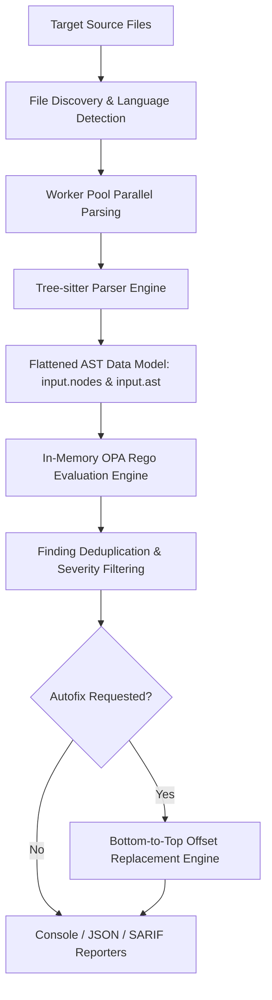

# TreeGuard Architecture & Technical Design

**TreeGuard** is a high-performance, multi-language Static Application Security Testing (SAST) engine that combines **Tree-sitter** for Abstract Syntax Tree (AST) parsing with **Open Policy Agent (OPA)** for declarative rule evaluation written in **Rego**.

---

## 1. High-Level Architecture

TreeGuard operates as an in-memory execution pipeline designed for ultra-fast scanning and high concurrency:



---

## 2. Parsing Subsystem (Tree-sitter)

TreeGuard uses native Go Tree-sitter bindings (`github.com/tree-sitter/go-tree-sitter`) supporting 12 programming languages:

| Language | File Extensions | Parser Grammar |
| :--- | :--- | :--- |
| **Python** | `.py`, `.pyi` | `tree-sitter-python` |
| **JavaScript** | `.js`, `.jsx`, `.mjs`, `.cjs` | `tree-sitter-javascript` |
| **TypeScript** | `.ts`, `.mts`, `.cts` | `tree-sitter-typescript` |
| **TSX** | `.tsx` | `tree-sitter-tsx` |
| **Go** | `.go` | `tree-sitter-go` |
| **Java** | `.java` | `tree-sitter-java` |
| **Rust** | `.rs` | `tree-sitter-rust` |
| **Ruby** | `.rb`, `.rake`, `.gemspec` | `tree-sitter-ruby` |
| **C** | `.c`, `.h` | `tree-sitter-c` |
| **C++** | `.cpp`, `.cc`, `.cxx`, `.hpp`, `.hxx` | `tree-sitter-cpp` |
| **PHP** | `.php` | `tree-sitter-php` |
| **JSON** | `.json` | `tree-sitter-json` |

### AST Data Transformation (`input`)
When a file is parsed, TreeGuard converts the raw concrete syntax tree (CST) into a dual JSON representation passed directly to OPA:

1. **`input.file`**: Metadata containing file path, language, total line count, and source line array.
2. **`input.nodes`**: Flattened array of indexed AST nodes. Each node contains:
   - `id` (int): Unique zero-based node index.
   - `parent_id` (int): Parent node index (-1 for root).
   - `type` (string): Grammar symbol type (e.g. `call_expression`, `identifier`, `assignment`).
   - `is_named` (bool): True if the node is a named AST node versus punctuation.
   - `range` (object): Line, column, and byte offsets (`start` and `end`).
   - `text` (string): Exact slice of source code corresponding to the node.
   - `children` ([]int): Array of child node IDs.
   - `ancestors` ([]int): Array of ancestor node IDs up to root.
   - `fields` (object): Field references mapping field names (e.g., `function`, `arguments`, `left`, `right`) to child node IDs.
3. **`input.ast`**: Hierarchical tree representation for recursive structural traversals.

---

## 3. Policy & Rule Evaluation Engine (OPA)

TreeGuard embeds OPA (`github.com/open-policy-agent/opa`) natively in Go:

* **Pre-compiled Rules**: Rego rules in `.rego` files are compiled in-memory once at startup into an OPA `rego.PreparedEvalQuery`.
* **Embedded Standard Library (`lib/sast.rego`)**: Common security matching functions (`sast.find_calls`, `sast.arg`, `sast.callee_node`, `sast.new_finding_with_fix`) are embedded at build time into every evaluation context.
* **Built-in S-Expression Pattern Queries (`sast.ts_query`)**: Custom Tree-sitter built-in function registered in Rego enabling native S-expression query matching:
  ```rego
  matches := sast.ts_query("(call_expression function: (identifier) @id (#eq? @id \"rand\"))")
  ```

---

## 4. Concurrency & Performance Model

TreeGuard scales linearly across multi-core systems:
- **Worker Pool Architecture**: Files discovered in target paths are distributed across worker goroutines (configurable via `-j / --threads`, defaulting to `runtime.NumCPU()`).
- **Zero Disk Re-reads**: Parsed AST data structures and source buffers are held in memory during evaluation.
- **Resource Management**: Tree-sitter C memory trees are explicitly freed via `p.Tree.Close()` upon evaluation completion.

---

## 5. Automated Remediation / Autofix Engine

TreeGuard provides safe, automated code replacements via `--fix` and `--dry-run`:

### Bottom-to-Top Replacement Algorithm
When multiple remediations affect a single file, modifying text at earlier byte offsets shifts all subsequent line/column/byte positions. To prevent offset drift:
1. Findings containing a `Fix` object are grouped per file.
2. Fixes per file are sorted in **descending order by byte offset** (`Fix.Range.Start.Byte`).
3. Replacements are executed from bottom-to-top, guaranteeing that byte offsets for earlier fixes remain 100% exact.
4. Overlapping edits are detected and safely skipped.

```text
File Buffer: [==================================================]
Fix #2 (Byte 80-90):               [REPLACE] -> "arc4random"
Fix #1 (Byte 20-25):  [REPLACE] -> "strncpy"
```

---

## 6. Output Generation & Reporters

TreeGuard supports three standardized reporter implementations (`internal/reporter`):

1. **Console Reporter**: Terminal output with colorized severity highlights, line numbers, source snippets, and `🛠  Autofix available` callouts.
2. **JSON Reporter**: Structured machine-readable schema containing execution statistics, findings, and remediation specifications.
3. **SARIF 2.1.0 Reporter**: OASIS SARIF v2.1.0 schema compliance for native integration into GitHub Advanced Security, GitLab Security Dashboards, and IDE plugins.
